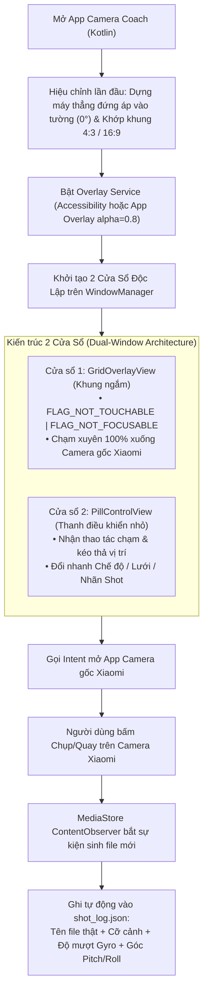
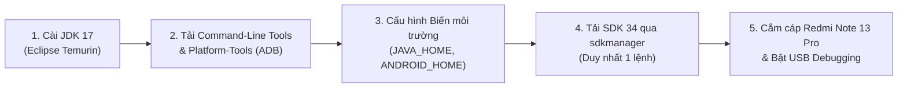

# TÀI LIỆU GIAI ĐOẠN 1 (v2.0): THIẾT KẾ APP MOBILE HỖ TRỢ QUAY CHỤP (CAMERA COACH)
**Thiết bị mục tiêu:** Xiaomi Redmi Note 13 Pro (Android 13/14 – Xiaomi HyperOS)  
**Mục tiêu cốt lõi:** Hỗ trợ người mới nắm vững bố cục, góc máy và chuyển động quay phim thông qua lớp phủ hướng dẫn trực quan thời gian thực đè trực tiếp lên Camera mặc định của máy.

> [!IMPORTANT]
> **NHẬT KÝ CẬP NHẬT v2.0 (SAU REVIEW & PHẢN BIỆN KỸ THUẬT) – Đánh giá khả thi: ~92%**
> 1. **Nâng cấp cơ chế chạm xuyên (Touch Pass-Through):** Bổ sung **`TYPE_ACCESSIBILITY_OVERLAY` (Accessibility Service)** bên cạnh `TYPE_APPLICATION_OVERLAY (alpha ≤ 0.8f)`. Cửa sổ Accessibility là *Trusted Overlay* nên **không bị Android 12+ giới hạn độ mờ 0.8** và **không bị HyperOS tự động kill ngầm**.
> 2. **Tối ưu Tech Stack (Bỏ Flutter, dùng 100% Native Kotlin):** Vì cả 2 cửa sổ nổi (`GridOverlayView` + `PillOverlayView`), cảm biến `TYPE_GAME_ROTATION_VECTOR` và `MediaStore Observer` đều phải viết bằng Kotlin, việc chuyển sang **Pure Native Kotlin (Jetpack Compose + Custom Canvas View)** giúp giảm 85% dung lượng app, không phải nuôi 2 Engine và loại bỏ hoàn toàn cầu nối `MethodChannel` phức tạp.
> 3. **Tự động hóa `shot_log.json` bằng `ContentObserver` (`MediaStore`):** Thay vì bắt người dùng tự bấm tick thủ công rồi so lệch giây đồng hồ, App lắng nghe sự kiện sinh file mới trong `DCIM/Camera` ngay khi bạn bấm dừng quay trên Camera Xiaomi để gắn nhãn chính xác 100% tên file thật (`VID_2026xxxx.mp4`) cùng góc Pitch/Roll và độ mượt lúc quay.
> 4. **Chuẩn hóa Toán học Cảm biến:** Dùng `TYPE_GAME_ROTATION_VECTOR` + tính trực tiếp từ Up Vector của ma trận xoay (không Gimbal Lock, tự nhận hướng cầm dọc/ngang từ trọng lực) + Calibration 0° + Hysteresis `0.3°` + Đo cả vận tốc góc ($\omega \le 0.25\ \text{rad/s}$) lẫn độ giật cục ($\sigma_\omega \le 0.08\ \text{rad/s}$).

---

## 1. TỪ ĐIỂN THUẬT NGỮ NHIẾP ẢNH & CÔNG NGHỆ (GLOSSARY)

### 1.1. Thuật ngữ Nhiếp ảnh & Quay phim (Photography & Videography Terms)

| Thuật ngữ | Tên tiếng Việt / Giải nghĩa | Ứng dụng thực tế khi quay chụp |
| :--- | :--- | :--- |
| **Composition** | **Bố cục:** Cách sắp xếp chủ thể, tiền cảnh, hậu cảnh trong khung hình. | Quyết định bức ảnh có hút mắt và có chiều sâu hay không. |
| **Rule of Thirds** | **Quy tắc 1/3:** Chia khung hình thành 9 phần bằng 2 đường dọc và 2 đường ngang. | Đặt mắt người hoặc chủ thể vào 4 giao điểm vàng; đặt đường chân trời vào vạch 1/3 trên hoặc dưới. |
| **Leading Lines** | **Đường dẫn:** Các đường thẳng/cong tự nhiên (con đường, lan can, bờ tường) dẫn mắt người xem vào chủ thể. | Tạo chiều sâu 3D mạnh mẽ cho ảnh phong cảnh và đường phố. |
| **Frame within a Frame** | **Khung trong khung:** Dùng cửa sổ, vòm cây, khung cửa để đóng khung chủ thể bên trong. | Giúp tập trung sự chú ý tuyệt đối vào chủ thể và che bớt phần rìa lộn xộn. |
| **Headroom & Lead Room** | **Headroom:** Khoảng trống trên đỉnh đầu.<br>**Lead Room:** Khoảng trống phía trước hướng nhìn/di chuyển. | Mẫu nhìn hoặc bước đi về hướng nào thì phải chừa khoảng trống nhiều hơn ở hướng đó (tỷ lệ 2/3). |
| **Keystone Effect** | **Hiệu ứng méo phối cảnh (Đổ cột):** Hiện tượng các tòa nhà nghiêng chụm vào nhau khi ngửa máy lên chụp. | Khi chụp kiến trúc, cần giữ máy thẳng đứng ($\text{Pitch} = 0^\circ$) để các đường dọc song song với mép khung hình. |
| **Shot Size (W-M-T)** | **Cỡ cảnh:** **W**ide (Toàn cảnh), **M**edium (Trung cảnh), **T**ight/Close-up (Cận cảnh). | Khi quay video để edit, luôn phải quay đủ 3 cỡ cảnh này để khi ghép không bị nhàm chán. |
| **A-Roll & B-Roll** | **A-Roll:** Cảnh chính (người nói chuyện, cốt truyện chính).<br>**B-Roll:** Cảnh phụ minh họa (cảnh pha cà phê, bước chân, phong cảnh). | B-Roll dùng để chèn đè lên A-Roll nhằm che các vết cắt lỗi (Jump Cut) và làm video giàu cảm xúc. |
| **Pan / Tilt / Orbit** | **Pan:** Lia máy ngang trái-phải (chân đứng yên).<br>**Tilt:** Lia máy dọc lên-xuống.<br>**Orbit (Arc):** Di chuyển vòng cung quanh chủ thể. | Các chuyển động máy cơ bản khi quay B-Roll để tạo cảm giác điện ảnh (Cinematic). |
| **OIS / EIS** | **OIS:** Chống rung quang học (`LENS_OPTICAL_STABILIZATION`).<br>**EIS:** Chống rung điện tử (`VIDEO_STABILIZATION`). | Redmi Note 13 Pro có OIS ở camera chính 200MP, rất lợi thế khi quay các cú máy lia chậm. |

### 1.2. Thuật ngữ Công nghệ & Hệ thống Android (Tech & System Terms)

| Thuật ngữ | Giải nghĩa kỹ thuật | Vai trò trong App Mobile |
| :--- | :--- | :--- |
| **`TYPE_GAME_ROTATION_VECTOR`** | Cảm biến hợp nhất (Sensor Fusion) kết hợp sẵn Gia tốc kế + Con quay hồi chuyển bằng bộ lọc Kalman phần cứng. | Cho ra góc nghiêng **Roll / Pitch** cực chuẩn, không bị nhiễu bởi gia tốc tay khi bạn vừa đi vừa lia máy và không bị nhiễu từ trường. |
| ** Gyroscope ($\omega$ & $\sigma_\omega$)** | Đo vận tốc góc xoay $\omega$ ($\text{rad}/s$) và độ lệch chuẩn $\sigma_\omega$ (độ giật cục của cổ tay). | Kiểm soát tốc độ lia máy B-Roll ($\omega \le 0.25\ \text{rad}/s \approx 14^\circ/s$) và cảnh báo nếu tay lia bị khựng/giật. |
| **Hysteresis (Vùng trễ)** | Khoảng đệm ($\pm 0.3^\circ$) khi chuyển trạng thái đạt/chưa đạt chuẩn góc máy. | Ngăn chặn hiện tượng khung viền nhấp nháy xanh/vàng liên tục hoặc rung phản hồi liên hồi khi góc máy nằm sát ngưỡng. |
| **`TYPE_ACCESSIBILITY_OVERLAY`** | Lớp phủ thuộc quyền Trợ năng (Accessibility Service) của Android. | **Giải pháp tối ưu trên Android 12+ / HyperOS:** Cho phép vẽ lưới sắc nét (độ đục 100%) mà vẫn chạm xuyên qua (`FLAG_NOT_TOUCHABLE`) và không bị Xiaomi tắt ngầm. |
| **`TYPE_APPLICATION_OVERLAY`** | Lớp phủ ứng dụng thông thường (`SYSTEM_ALERT_WINDOW`). | Phương án dự phòng: Trên Android 12+ bắt buộc phải đặt `layoutParams.alpha = 0.8f` trở xuống để hệ thống cho phép chạm xuyên qua. |
| **`MediaStore ContentObserver`** | Trình lắng nghe sự kiện thay đổi file ảnh/video của hệ điều hành Android. | Tự động phát hiện ngay khi Camera Xiaomi vừa lưu file ảnh/video mới để ghi tên file thật và thông số góc máy vào `shot_log.json`. |

---

## 2. CƠ SỞ KIẾN THỨC NHIẾP ẢNH & BỘ NGƯỠNG CHUẨN (`rules_data.json`)

Toàn bộ các ngưỡng dưới đây được lưu tập trung trong một file cấu hình duy nhất (`rules_data.json`) kèm theo vùng trễ **Hysteresis = $0.3^\circ$**:

### 2.1. Chế độ 1: Chân dung (Portrait Mode)
* **Bán thân (Half-body):**
  * **Lưới hiển thị:** Lưới 1/3 + Vạch ngang đánh dấu vị trí đặt mắt (Eye-line tại 1/3 trên).
  * **Ngưỡng cảm biến:** $\text{Pitch} \in [-3.0^\circ, +3.0^\circ]$ (Cầm máy ngang tầm mắt mẫu), $|\text{Roll}| \le 1.5^\circ$.
  * **Quy tắc nhắc nhở:** *"Đặt mắt mẫu vào vạch ngang 1/3 trên. Không cắt ngang khuỷu tay/cổ tay. Chọn ống kính 2x để xóa phông và chống méo mặt."*
* **Toàn thân (Full-body - Hack chiều cao):**
  * **Lưới hiển thị:** Lưới 1/3 + Vạch giới hạn bàn chân sát mép dưới (chừa 5% khoảng trống dưới chân) + Khung gợi ý dáng đứng tam giác.
  * **Ngưỡng cảm biến:** $\text{Pitch} \in [+5.0^\circ, +12.0^\circ]$ (Hạ máy thấp ngang thắt lưng và hơi ngửa máy lên), $|\text{Roll}| \le 1.5^\circ$.
  * **Quy tắc nhắc nhở:** *"Mép dưới khung hình chạm sát mũi giày. Đầu mẫu nằm ở khoảng giữa khung hình."*

### 2.2. Chế độ 2: Phong cảnh (Landscape Mode)
* **Lưới hiển thị:** Thước thủy cân bằng + Lưới 1/3 ngang + Đường dẫn chữ S / Đường chéo.
* **Ngưỡng cảm biến:** $|\text{Roll}| \le 1.0^\circ$ (Tuyệt đối không nghiêng đường chân trời).
* **Quy tắc nhắc nhở:** *"Trời đẹp đặt chân trời 1/3 dưới; Đất đẹp đặt 1/3 trên. Luôn tìm 1 vật thể làm Tiền cảnh tạo chiều sâu 3 lớp."*

### 2.3. Chế độ 3: Kiến trúc & Nội thất (Architecture Mode)
* **Lưới hiển thị:** Trục đối xứng chữ thập chính giữa + Các đường gióng dọc song song (Vertical Grid).
* **Ngưỡng cảm biến:** $\text{Pitch} \in [-1.5^\circ, +1.5^\circ]$ và $|\text{Roll}| \le 1.0^\circ$ (Máy vuông góc hoàn toàn với mặt đất để cột nhà không đổ nghiêng).
* **Quy tắc nhắc nhở:** *"Muốn lấy trọn đỉnh tòa nhà, hãy lùi ra xa hoặc chuyển sang 0.6x nhưng vẫn giữ Pitch = 0° thay vì ngửa máy lên."*

### 2.4. Chế độ 4: Đường phố & Đời thường (Street / Lifestyle)
* **Lưới hiển thị:** Xoắn ốc Tỷ lệ vàng (Fibonacci Spiral - có nút lật 4 hướng) + Khung hướng nhìn (*Looking Room*).
* **Ngưỡng cảm biến:** $|\text{Roll}| \le 2.0^\circ$.
* **Quy tắc nhắc nhở:** *"Đặt chủ thể vào tâm xoắn ốc. Chừa khoảng trống 2/3 khung hình ở phía trước hướng di chuyển của nhân vật."*

### 2.5. Chế độ 5: Quay Video B-Roll (Cinematic Video Coach)
* **Lưới hiển thị:** Mũi tên Vector hướng dẫn chiều lia máy + Thanh đếm nhịp **5 giây** (1s đệm đầu + 3s hành động chính + 1s đệm cuối).
* **Ngưỡng cảm biến (Gyroscope Window 300ms):**
  1. **Tốc độ lia trung bình ($\bar{\omega}$):** Phải nằm trong khoảng $[0.08, 0.25]\ \text{rad/s}$ ($\approx 4.5^\circ/s \to 14.3^\circ/s$). Nếu $\bar{\omega} > 0.25\ \text{rad/s} \rightarrow$ Cảnh báo vàng: *"Lia máy quá nhanh! Hãy chậm lại."*
  2. **Độ đều tay / Chống giật ($\sigma_\omega$):** Độ lệch chuẩn của vận tốc góc trong 300ms phải $\le 0.08\ \text{rad/s}$. Nếu vượt ngưỡng $\rightarrow$ Cảnh báo: *"Tay đang bị khựng, hãy khóa cổ tay và di chuyển bằng cả cơ thể!"*
* **Tổ hợp 5 cú máy (5-Shot Sequence Tags):** Cho phép bấm chọn nhanh nhãn trên thanh nổi trước khi quay:
  * `[WIDE]` (Toàn cảnh) | `[MED]` (Trung cảnh) | `[TIGHT-HANDS]` (Cận tay) | `[TIGHT-FACE]` (Cận mặt) | `[OTS]` (Qua vai).

---

## 3. KIẾN TRÚC KỸ THUẬT: FLOATING EXTENSION ĐÈ LÊN CAMERA XIAOMI

Thay vì viết lại một ứng dụng Camera bên thứ 3 (vốn bị giới hạn ở 12.5MP, mất thuật toán HDR/màu sắc của Xiaomi và không mở được đầy đủ các ống kính phụ), ứng dụng sẽ hoạt động như một **Lớp phủ Hệ thống (System HUD Extension)** đè trực tiếp lên App Camera gốc của Redmi Note 13 Pro.



### 3.1. Giải quyết triệt để 4 bài toán kỹ thuật trên Xiaomi HyperOS

1. **Vượt rào cản "Untrusted Touch Block" của Android 12+:**
   * **Cách 1 (Khuyên dùng cho máy cá nhân):** Đăng ký một `AccessibilityService` tối giản và tạo cửa sổ với cờ `WindowManager.LayoutParams.TYPE_ACCESSIBILITY_OVERLAY`. Hệ điều hành Android coi đây là lớp phủ tin cậy (Trusted Overlay), cho phép hiển thị nét vẽ độ sáng `alpha = 1.0f` rõ rệt dưới trời nắng mà vẫn truyền 100% thao tác chạm xuyên xuống Camera Xiaomi. Đồng thời HyperOS **không bao giờ tự động tắt ngầm** dịch vụ này.
   * **Cách 2 (Không cần bật Accessibility):** Dùng `TYPE_APPLICATION_OVERLAY` trong một `ForegroundService` (`specialUse`) và đặt cứng `layoutParams.alpha = 0.78f` (nhỏ hơn ngưỡng `0.8f` của Android 12+).
2. **Tách biệt hoàn toàn 2 Cửa sổ (`GridWindow` và `PillWindow`):**
   * Vì cờ `FLAG_NOT_TOUCHABLE` áp dụng cho toàn bộ một Window, `OverlayService.kt` sẽ gọi `windowManager.addView()` **2 lần** cho 2 View độc lập:
     * `GridOverlayView`: Chỉ vẽ đồ họa Canvas, hoàn toàn vô hình với ngón tay.
     * `PillOverlayView`: Một thanh nhỏ gọn ở rìa màn hình để bấm chọn chế độ (`Portrait`, `Landscape`, `B-Roll`) và chọn nhãn cỡ cảnh (`WIDE`, `MED`, `TIGHT`).
3. **Khớp chính xác vùng khung ngắm (Viewfinder Calibration):**
   * Trên Camera Xiaomi, khung ngắm Ảnh (tỷ lệ `4:3`) và Video (tỷ lệ `16:9`) nằm ở tọa độ màn hình khác nhau (phần còn lại là hai dải đen chứa nút chụp và thanh thông số).
   * App có sẵn 2 bộ khung tọa độ chuẩn (`4:3` và `16:9`) cho màn hình 20:9 của Redmi Note 13 Pro, kèm nút **"Cân chỉnh khung"** cho phép kéo mép trên/dưới của lưới khớp khít 100% với mép preview của Camera Xiaomi và lưu lại vĩnh viễn vào `SharedPreferences`.
4. **Tự động gắn nhãn file quay qua `MediaStore ContentObserver`:**
   * Khi bạn đang bật chế độ `B-Roll` và chọn nhãn `[TIGHT-HANDS]` trên thanh Pill, bạn chỉ việc bấm nút Quay và Dừng quay trên Camera Xiaomi như bình thường.
   * Ngay khi file `VID_20261103_152030.mp4` vừa được Camera Xiaomi lưu vào bộ nhớ, `ContentObserver` của App phát hiện ngay lập tức và ghi thêm 1 bản ghi vào `/Documents/CameraCoach/shot_log.json`:
     ```json
     {
       "file_name": "VID_20261103_152030.mp4",
       "timestamp": 1793694030,
       "mode": "BROLL",
       "shot_tag": "TIGHT_Hands",
       "avg_pitch_deg": -12.4,
       "avg_roll_deg": 0.4,
       "max_gyro_rad_s": 0.18,
       "is_smooth": true
     }
     ```
   * Khi chép thư mục video sang Laptop ThinkBook, MCP Server đọc file `shot_log.json` này là biết chính xác từng file `VID_...mp4` quay cảnh gì, có bị rung hay không mà bạn **không cần đổi tên thủ công và không cần dùng In-App CameraX!**

---

## 4. CÔNG THỨC XỬ LÝ CẢM BIẾN CHUẨN XÁC (NATIVE KOTLIN)

Sử dụng `Sensor.TYPE_GAME_ROTATION_VECTOR` và tính toán trực tiếp từ Vector Thiên Đỉnh (**Up Vector**) trong Ma trận xoay. Cách tiếp cận này **triệt tiêu hoàn toàn hiện tượng Gimbal Lock (Khóa trục)** khi cầm máy dọc để chụp ảnh, đồng thời tự động nhận diện hướng xoay máy từ trọng lực mà không phụ thuộc vào `display.rotation` (vốn bị Camera Xiaomi khóa cứng ở `ROTATION_0`):

```kotlin
// 1. Chuyển Vector cảm biến thành Ma trận xoay 3x3
SensorManager.getRotationMatrixFromVector(rotationMatrix, event.values)

// 2. Vector "Up" (thiên đỉnh) của thế giới thực quy đổi vào hệ trục tọa độ điện thoại:
// R biến đổi từ device -> world, ma trận trực giao R^-1 = R^T
// v_dev = R^T * [0, 0, 1]^T = [R[6], R[7], R[8]]^T
val upX = rotationMatrix[6]
val upY = rotationMatrix[7]
val upZ = rotationMatrix[8]

// 3. Tính góc Pitch (chúc/ngửa camera -Z) trực tiếp từ upZ — Triệt tiêu 100% Gimbal Lock:
// Khi cầm máy dựng đứng: pitch = 0°; ngửa lên trời (+): pitch > 0°; chúc xuống đất (-): pitch < 0°
val rawPitchDeg = Math.toDegrees(asin(-upZ.coerceIn(-1f, 1f).toDouble())).toFloat()
val pitchDeg = rawPitchDeg - calibPitchOffset

// 4. Nhận diện góc xoay trong mặt phẳng máy (Roll) và hướng cầm máy (Dọc/Ngang) từ trọng lực.
// Bỏ qua khi máy gần nằm ngang (quay flat-lay) vì upX, upY ≈ 0 khiến atan2 nhảy loạn:
if (sqrt(upX * upX + upY * upY) >= 0.3f) {
    val rawAngleDeg = Math.toDegrees(atan2(upX.toDouble(), upY.toDouble())).toFloat()
    val (deviceRotation, horizonRoll) = resolveRotationAndHorizon(rawAngleDeg)
    latestRawRollDeg = horizonRoll
}
val rollDeg = latestRawRollDeg - calibRollOffset

// 5. Cửa sổ trượt Gyroscope 300ms đo tốc độ lia (ω) và độ giật cổ tay (σ_ω) bằng timestamp phần cứng (ns):
// Tốc độ lia chuẩn: ω in [0.08, 0.25] rad/s; Độ giật cổ tay: σ_ω <= 0.08 rad/s

// 6. Chỉ vẽ lại Canvas (invalidate) khi góc thay đổi > 0.15 độ để tiết kiệm Pin & chống nóng máy:
if (abs(rollDeg - lastRollDeg) > 0.15f || abs(pitchDeg - lastPitchDeg) > 0.15f) {
    gridOverlayView.updateTelemetry(telemetry)
}
```

---

## 5. HƯỚNG DẪN THIẾT LẬP MÔI TRƯỜNG SIÊU NHẸ (HƯỚNG B: KHÔNG CẦN ANDROID STUDIO)

Bạn **hoàn toàn không cần cài Android Studio** (tiết kiệm ~4GB dung lượng ổ cứng và không tốn 2GB RAM chạy nền của IDE). Chúng ta sẽ thiết lập một chuỗi công cụ dòng lệnh (CLI Toolchain) tối giản, siêu tốc trên chiếc ThinkBook 16 G6.

### 5.1. So sánh tài nguyên: Android Studio vs. Toolchain Siêu Nhẹ (Hướng B)

| Tiêu chí | Cài đặt Android Studio đầy đủ | Toolchain Dòng lệnh Siêu nhẹ (Hướng B) |
| :--- | :--- | :--- |
| **Dung lượng tải về** | ~1.2 GB | **~250 MB** |
| **Dung lượng sau khi cài** | 3.5 GB – 5.0 GB | **~750 MB** (JDK + SDK cốt lõi) |
| **RAM tiêu thụ khi không chạy**| 1.5 GB – 2.5 GB (khi mở IDE) | **0 MB** (chỉ tốn CPU vài giây lúc bấm Build) |
| **Trình soạn thảo mã nguồn** | IntelliJ IDE tích hợp sẵn | **VS Code** (hoặc Antigravity trực tiếp viết code) |
| **Cách nạp app vào điện thoại** | Bấm nút Run hình tam giác | Chạy 1 dòng lệnh PowerShell: `adb install` |

### 5.2. Các bước cài đặt chi tiết trên Windows 11 (ThinkBook 16 G6)



#### Bước 1: Cài đặt JDK 17 (Java Development Kit)
Gradle và trình biên dịch Kotlin yêu cầu JDK 17.
* **Cách nhanh nhất qua PowerShell:** Mở PowerShell với quyền Administrator và gõ:
  ```powershell
  winget install EclipseAdoptium.Temurin.17.JDK
  ```
* Hoặc tải file `.msi` từ trang chính thức: [adoptium.net](https://adoptium.net) (chọn bản LTS 17). Bản cài tự động gán biến môi trường cho bạn.
* **Kiểm tra:** Mở cửa sổ PowerShell mới, gõ:
  ```powershell
  java -version
  ```
  *(Hiện ra `openjdk version "17.0.x"` là thành công).*

#### Bước 2: Tải Android Command-Line Tools & Platform-Tools (ADB)
1. Tạo một thư mục gốc lưu SDK trên ổ đĩa, ví dụ: `C:\AndroidSDK\`.
2. Tải 2 gói `.zip` nhỏ từ trang chính thức của Google:
   * **Command-line tools:** Cuộn xuống mục *Command line tools only* tại [developer.android.com/studio#command-tools](https://developer.android.com/studio#command-tools) $\rightarrow$ Tải file `commandlinetools-win-xxxxxxx_latest.zip` (~150MB).
   * **Platform-tools (chứa ADB):** Tải file `platform-tools-latest-windows.zip` (~20MB) tại [developer.android.com/tools/releases/platform-tools](https://developer.android.com/tools/releases/platform-tools).
3. **Giải nén theo đúng cấu trúc thư mục quy định của Google:**
   * Gói `commandlinetools`: Giải nén và đổi tên thư mục thành: `C:\AndroidSDK\cmdline-tools\latest\` *(Lưu ý: Bên trong thư mục `latest` phải chứa ngay các thư mục con `bin`, `lib`...)*.
   * Gói `platform-tools`: Giải nén vào: `C:\AndroidSDK\platform-tools\`.

#### Bước 3: Cấu hình Biến môi trường Windows (Environment Variables)
Mở Start menu $\rightarrow$ Gõ **"env"** $\rightarrow$ Chọn **Edit the system environment variables** $\rightarrow$ Bấm nút **Environment Variables...**:

1. **Tại mục System variables (Biến hệ thống), bấm *New...* để thêm 2 biến mới:**
   * **Biến 1:**  
     * Variable name: `ANDROID_HOME`  
     * Variable value: `C:\AndroidSDK`
   * **Biến 2:** (Nếu chưa có)  
     * Variable name: `JAVA_HOME`  
     * Variable value: `C:\Program Files\Eclipse Adoptium\jdk-17.x.x-hotspot\` *(Đường dẫn tới thư mục JDK 17 vừa cài)*
2. **Chỉnh sửa biến `Path`:**
   * Chọn dòng `Path` trong System variables $\rightarrow$ Bấm **Edit...** $\rightarrow$ Bấm **New** và thêm lần lượt 3 dòng sau:
     * `%JAVA_HOME%\bin`
     * `%ANDROID_HOME%\cmdline-tools\latest\bin`
     * `%ANDROID_HOME%\platform-tools`
3. Bấm **OK** để lưu lại tất cả.

#### Bước 4: Tải gói SDK Android 14 (API 34) bằng 1 lệnh duy nhất
Mở một cửa sổ PowerShell mới và chạy lệnh sau để tải trình biên dịch Android 34:
```powershell
# Chấp nhận các điều khoản bản quyền của Google
sdkmanager --licenses

# Tải bộ công cụ biên dịch Android 14 (API 34)
sdkmanager "platforms;android-34" "build-tools;34.0.0"
```
*(Chờ khoảng 1–2 phút để tải xong gói SDK ~200MB).*

#### Bước 5: Cấu hình kết nối Redmi Note 13 Pro qua ADB
1. **Trên điện thoại:**
   * Vào **Cài đặt** $\rightarrow$ **Giới thiệu điện thoại** $\rightarrow$ Chạm **7 lần** vào dòng **HyperOS version** để mở *Tùy chọn nhà phát triển*.
   * Vào **Cài đặt bổ sung** $\rightarrow$ **Tùy chọn nhà phát triển** $\rightarrow$ Bật:
     * **Gỡ lỗi USB (USB debugging)**
     * **Cài đặt qua USB (Install via USB)**
     * **Gỡ lỗi USB (Cài đặt bảo mật)**
2. **Cắm cáp Type-C kết nối điện thoại với laptop:**
   * Màn hình điện thoại sẽ hiện hộp thoại *"Cho phép gỡ lỗi USB từ máy tính này?"* $\rightarrow$ Tích chọn **Luôn cho phép** $\rightarrow$ Bấm **OK**.
3. **Kiểm tra kết nối trên PowerShell:**
   ```powershell
   adb devices
   ```
   *Nếu hiện ra danh sách dạng:*
   ```text
   List of devices attached
   a8b7c6d5    device
   ```
   *(Nghĩa là laptop đã sẵn sàng nạp thẳng ứng dụng vào điện thoại của bạn!).*

---

### 5.3. Quy trình làm việc hàng ngày bằng Dòng lệnh (Day-to-Day CLI Workflow)

Toàn bộ quá trình lập trình, build và sửa lỗi sau này sẽ diễn ra bằng **3 lệnh PowerShell đơn giản**:

```powershell
# Di chuyển vào thư mục dự án Camera Coach
cd D:\CameraCoachExtension

# LỆNH 1: Biên dịch ứng dụng ra file APK (Chạy mất khoảng 5 - 10 giây)
./gradlew assembleDebug

# LỆNH 2: Nạp và cài đặt thẳng vào Redmi Note 13 Pro
adb install -r app/build/outputs/apk/debug/app-debug.apk

# LỆNH 3: Bật ứng dụng từ xa qua lệnh ADB
adb shell am start -n com.coach.camera/.MainActivity

# LỆNH 4: Xem nhật ký hoạt động hoặc theo dõi lỗi (Logcat) thời gian thực
adb logcat -s CameraCoach OrientationEngine MediaShotLogger
```

> [!TIP]
> **Kịch bản tự động 1-Click (`deploy.bat`):**  
> Bạn có thể tạo sẵn 1 file `deploy.bat` ngay trong thư mục dự án:
> ```bat
> call ./gradlew assembleDebug && adb install -r app/build/outputs/apk/debug/app-debug.apk && adb shell am start -n com.coach.camera/.MainActivity
> ```
> Mỗi khi viết code xong, chỉ cần gõ `.\deploy.bat` là máy tự build, tự cài và tự mở app trên điện thoại của bạn trong đúng 10 giây!

---

## 6. CẤU TRÚC DỰ ÁN NATIVE ANDROID (KOTLIN) ĐỀ XUẤT

Việc chuyển từ Flutter sang **100% Native Kotlin** giúp dự án cực kỳ gọn nhẹ, chỉ gồm đúng 7 file mã nguồn chính:

```text
CameraCoachExtension/
├── app/src/main/
│   ├── AndroidManifest.xml             # Khai báo SYSTEM_ALERT_WINDOW, Accessibility & MediaStore
│   ├── assets/
│   │   ├── poses/                      # Khung SVG gợi ý dáng chụp (Đứng, ngồi, bước đi...)
│   │   └── rules_data.json             # Ngưỡng Pitch, Roll, Gyro và lời nhắc cho 5 chế độ
│   └── kotlin/com/coach/camera/
│       ├── MainActivity.kt             # Màn hình chính: Bật/tắt Coach, Hiệu chỉnh 0° & Khung 4:3/16:9
│       ├── CoachOverlayService.kt      # Quản lý vòng đời 2 cửa sổ nổi (GridWindow + PillWindow)
│       ├── sensor/
│       │   └── OrientationEngine.kt    # Đọc TYPE_GAME_ROTATION_VECTOR, Gyro平滑 & Hysteresis
│       ├── overlay/
│       │   ├── GridOverlayView.kt      # Custom View vẽ Lưới 1/3, Xoắn ốc, Thước thủy, Mũi tên B-Roll
│       │   └── PillControlView.kt      # Thanh công cụ nổi thu gọn để chọn Chế độ & Nhãn cỡ cảnh
│       └── logger/
│           └── MediaShotLogger.kt      # ContentObserver bắt file VID_...mp4 mới & ghi shot_log.json
└── build.gradle.kts
```

---

## 7. LỘ TRÌNH TRIỂN KHAI GIAI ĐOẠN 1 (ĐÃ HIỆU CHỈNH THỰC TẾ)

| Bước | Hạng mục công việc | Thời gian thực tế | Tiêu chí hoàn thành (Definition of Done) |
| :--- | :--- | :--- | :--- |
| **Bước 1 (Spike Test)** | Tạo project Kotlin tối giản: Mở 2 cửa sổ (`GridView` không nhận chạm + `PillView` nhận chạm) đè lên Camera Xiaomi | **1 ngày** | Mở Camera Xiaomi trên Redmi Note 13 Pro, thấy lưới hiện đè lên, bấm chụp/lấy nét xuyên qua lưới mượt 100%, bấm được nút trên thanh Pill. |
| **Bước 2 (Core Sensor)** | Lập trình `OrientationEngine.kt` (`TYPE_GAME_ROTATION_VECTOR` + Gyro + Xoay ngang/dọc + Calibration 0°) | **2 – 3 ngày** | Thước thủy đổi sang màu Xanh lá + rung nhẹ 1 nhịp (Edge-trigger) khi cân bằng; báo vàng khi lia máy quá nhanh ($> 0.25\ \text{rad/s}$). |
| **Bước 3 (Visual & Modes)** | Vẽ bộ Lưới cho 5 chế độ (`rules_data.json`), khung dáng SVG và thanh đếm nhịp 5s cho B-Roll | **3 – 4 ngày** | Chuyển đổi mượt giữa 5 chế độ trên thanh Pill; khung lưới khớp chính xác với vùng ngắm `4:3` và `16:9` của Camera Xiaomi. |
| **Bước 4 (Shot Logger)** | Lập trình `MediaShotLogger.kt` tự động ghi `shot_log.json` mỗi khi chụp/quay xong | **1 – 2 ngày** | Quay thử 3 clip B-Roll, mở file `shot_log.json` thấy ghi đúng tên file `VID_...mp4` kèm nhãn cỡ cảnh và độ mượt. |

---

## 8. KHẢ NĂNG TƯƠNG THÍCH ĐA THIẾT BỊ & LỘ TRÌNH MỞ RỘNG (MULTI-DEVICE EXPANSION)

Mặc dù **Xiaomi Redmi Note 13 Pro (HyperOS)** được chọn làm thiết bị chuẩn để Demo và tinh chỉnh trong Giai đoạn 1, toàn bộ kiến trúc mã nguồn hiện tại được xây dựng trên chuẩn **Android AOSP (API 26 – 34+)** nên **không bị khóa cứng vào phần cứng Xiaomi** và có thể chạy ngay trên các dòng máy **Samsung (One UI), Google Pixel, OPPO (ColorOS), Vivo (OriginOS/Funtouch), Realme, OnePlus, Sony Xperia...**

### 8.1. Các thành phần trong mã nguồn hiện tại đã tương thích sẵn đa thiết bị

1. **Cảm biến & Toán học (`OrientationEngine.kt`):**
   * Sử dụng API chuẩn `Sensor.TYPE_GAME_ROTATION_VECTOR` và tự động lùi về (`fallback`) `Sensor.TYPE_ROTATION_VECTOR` đối với các dòng máy phổ thông không trang bị cảm biến Game Rotation riêng.
   * Góc Pitch/Roll tính trực tiếp từ Up Vector của ma trận xoay và hướng cầm máy suy ra từ trọng lực, nên không phụ thuộc việc app Camera của từng hãng có khóa UI dọc hay không.
2. **Lớp phủ chạm xuyên (`CoachOverlayService.kt`):**
   * Cơ chế giới hạn chạm xuyên (`alpha <= 0.8f`) đối với `TYPE_APPLICATION_OVERLAY` và quyền ưu tiên *Trusted Overlay* của `TYPE_ACCESSIBILITY_OVERLAY` (`alpha = 1.0f`) là quy chuẩn bảo mật chung của nhân **Android 12+ (Google AOSP)**, hoạt động giống hệt nhau trên mọi bản ROM của các hãng.
3. **Khung ngắm thích ứng mọi tỷ lệ màn hình (`GridOverlayView.kt` & `PillControlView.kt`):**
   * Không gán cứng độ phân giải pixel (`1080x2400`) mà lưu theo **tọa độ chuẩn hóa phần trăm (`0.0f .. 1.0f`)** kết hợp tính năng **`📐 KHỚP KHUNG`** trực tiếp trên thanh nổi (`▲/▼ ±1%`). Nhờ đó, dù cài lên màn hình tỷ lệ `19.5:9`, `20:9` hay `21:9`, người dùng đều có thể căn chỉnh khớp 100% với vùng preview của Camera máy đó và lưu vào `SharedPreferences`.
4. **Mở Camera & Tự động bắt file (`MainActivity.kt` & `MediaShotLogger.kt`):**
   * Nếu thiết bị không phải Xiaomi (không có gói `com.android.camera` / `com.miui.camera`), ứng dụng tự động gọi `MediaStore.INTENT_ACTION_STILL_IMAGE_CAMERA` để mở ứng dụng Camera mặc định của máy.
   * `MediaShotLogger` đọc trực tiếp trường `MediaStore.MediaColumns.DISPLAY_NAME`, nên dù các hãng đặt quy tắc tên file khác nhau (Xiaomi: `VID_2026xxxx.mp4`, Samsung: `20261103_xxxx.mp4`, Google Pixel: `PXL_2026xxxx.mp4`), file `shot_log.json` đều ghi nhận chính xác 100%.

### 8.2. Lộ trình nâng cấp khi mở rộng sang nhiều dòng thiết bị thương mại

Khi phát triển từ bản Demo cá nhân sang bản phân phối rộng rãi cho nhiều hệ máy, dự án sẽ mở rộng theo 4 hạng mục sau:

| Hạng mục nâng cấp | Giải pháp kỹ thuật chi tiết |
| :--- | :--- |
| **1. Tự động khớp khung ngắm theo hãng (`OEM Viewfinder Profiles`)** | Đọc `Build.MANUFACTURER` & `Build.MODEL` kết hợp công thức toán học: chiều cao khung `4:3` luôn bằng $\text{ScreenWidth} \times \frac{4}{3}$ và khung `16:9` bằng $\text{ScreenWidth} \times \frac{16}{9}$. Bổ sung file cấu hình `oem_viewfinder_offsets.json` chứa vị trí thanh Top Bar của từng hãng (Samsung, Xiaomi, OPPO, Pixel, Vivo) để vừa cài app là khớp sẵn 100% không cần chỉnh tay. |
| **2. Tự động Hiện/Ẩn HUD khi mở/thoát Camera (`Auto-Show/Hide`)** | Tận dụng sự kiện `TYPE_WINDOW_STATE_CHANGED` của `CoachAccessibilityService` để kiểm tra `event.packageName`. Khi phát hiện người dùng mở ứng dụng Camera thuộc danh sách trắng (`com.android.camera`, `com.sec.android.app.camera`, `com.google.android.GoogleCamera`, `com.oplus.camera`, `com.vivo.camera`...) thì **tự động bật 2 cửa sổ HUD**; khi người dùng vuốt ra màn hình chính hoặc chuyển sang app khác thì **tự động ẩn HUD**. |
| **3. Hỗ trợ Điện thoại màn hình gập (`Foldables`) & Tablet** | Lắng nghe sự kiện `onConfigurationChanged` trong `CoachOverlayService` để tự động tính toán lại kích thước cửa sổ và ma trận cảm biến khi người dùng gập/mở màn hình (ví dụ dòng Samsung Galaxy Z Fold / Z Flip). |
| **4. Hướng phát triển phiên bản iOS (iPhone)** | Do hệ điều hành iOS đóng hộp (`Sandbox`) không cho phép vẽ lớp phủ đè lên ứng dụng Camera gốc của Apple, phiên bản iOS sẽ được phát triển dưới dạng **In-App Camera sử dụng `AVFoundation`**. Điểm thuận lợi là trên iOS, Apple mở toàn bộ API chất lượng cao nhất (`Apple ProRAW 48MP`, `Apple Log`, `ProRes`, chống rung OIS phần cứng và toàn bộ ống kính `0.5x / 1x / 2x / 5x`) cho ứng dụng bên thứ 3. |

